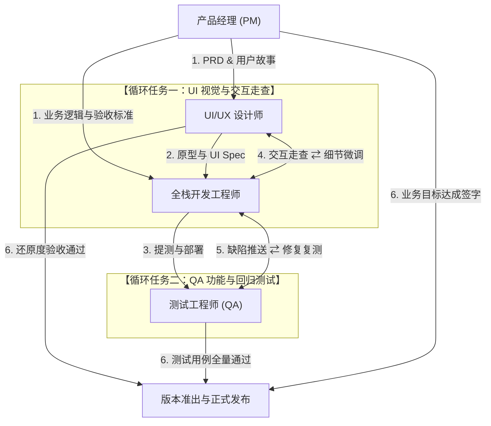

# 产品全生命周期开发流程与循环协同通信规范 (SOP)

## 一、宏观研发流转图

## 二、阶段协作与循环通信协议

### 阶段 1：需求定义与评审（PM 主导）
- **输出物**：`prd.md`、`user-stories.md`、`roadmap.md`。
- **动作**：PM 召集 UI、开发与 QA 进行三方交底与可行性评审，冻结需求基线。

### 阶段 2：交互视觉与架构设计（UI & 开发并行）
- **输出物**：UI 产出 `information-architecture.md`、`ui-spec.md`；开发产出 `tech-stack.md`、`api.md`。
- **动作**：开发根据 UI Spec 确定组件粒度，QA 同步编写 `test-plan.md` 与 `test-cases.md`。

### 阶段 3：全栈编码实现与持续提测（全栈开发主导）
- **输出物**：工程功能代码、单元测试、本地提测环境。
- **动作**：完成核心页面与 API 联调，生成可交互的提测版本。

### 阶段 4：双轨循环走查与收敛闭环（UI & QA 协同，核心循环）
1. **UI 视觉与体验走查循环**：
   - UI 设计师检视运行页面，对照 Design Tokens、栅格对齐、悬停态与动效；
   - 发现还原度偏差时，向开发提交走查清单；
   - 开发修正样式后，UI 再次复核，直到视觉与交互 100% 达标。
2. **QA 质量与逻辑回归循环**：
   - QA 依据测试用例跑通正向与极端边界用例，运行自动化脚本；
   - 发现 Bug 立即上报，开发定位排查并提交修复代码；
   - QA 执行针对性验证与全量回归，循环直至零 P0/P1 缺陷。

### 阶段 5：三方联合验收与发布放行
- UI 确认还原度通过、QA 出具 `release-report.md`、PM 确认核心业务目标达成，正式合并主干发版。
