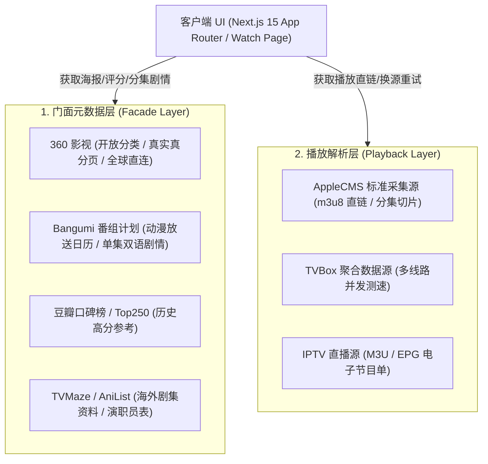

# LibreTV 工程开发与协作规范 (Development Specification)

> 本规范是 LibreTV 项目的核心工程准则，所有参与维护的开发者与智能体必须严格遵守。

---

## 目录
- [一、 Git 工作流与 CI/CD 交付规范（严禁直接推 Master）](#一-git-工作流与-cicd-交付规范严禁直接推-master)
- [二、 系统架构与数据链路分层](#二-系统架构与数据链路分层)
- [三、 前端 UI/UX 视觉工程与设计系统规范](#三-前端-uiux-视觉工程与设计系统规范)
- [四、 性能优化与图片加载准则](#四-性能优化与图片加载准则)
- [五、 代码质量、测试与防御性工程纪律](#五-代码质量测试与防御性工程纪律)

---

## 一、 Git 工作流与 CI/CD 交付规范（严禁直接推 Master）

### 1. 核心红线：严禁直接 Push 到 Master
- **生产直连风险**：`Master` 分支受 Render / Vercel / 生产容器 CD 监听。任何推送到 `Master` 的行为都会**直接触发线上生产环境自动部署**。
- **门禁机制**：CI 的 GitHub Actions 门禁是为 **Pull Request 与功能分支** 设计的强阻断门禁。直接推送到 `Master` 会导致 CI 变为“事后记录”，一旦引入坏代码将直接打爆生产环境。

### 2. 标准分支开发流 (Branching Model)
日常开发与 Bug 修复必须严格执行标准化流水线：

```mermaid
gitGraph
   commit id: "Initial"
   branch feature/recommend-carousel
   checkout feature/recommend-carousel
   commit id: "feat: 横向滚动轨道"
   commit id: "test: 补充单测"
   checkout Master
   merge feature/recommend-carousel id: "PR #12 Merged"
   branch fix/badge-episodes
   checkout fix/badge-episodes
   commit id: "fix: 恢复更新集数角标"
   checkout Master
   merge fix/badge-episodes id: "PR #13 Merged"
```

1. **同步主干**：
   ```bash
   git checkout Master
   git pull origin Master
   ```
2. **基于主干切出特性/修复分支**：
   - 新需求/新功能：`feature/功能描述`（如 `feature/episode-intro`、`feature/overseas-catalog`）
   - 问题修复：`fix/缺陷描述`（如 `fix/douban-418-cover`、`fix/episode-badge-loss`）
   - 紧急修复：`hotfix/故障描述`
   - 重构优化：`refactor/模块名称`
   - 文档与规范：`docs/规范说明`
3. **本地开发与门禁自验**（提交前必跑，缺一不可）：
   ```bash
   npm run typecheck    # 1. TypeScript 类型校验（0 错误）
   npm test             # 2. Vitest 全量单元测试（399+ 用例全绿）
   npm run build        # 3. Next.js 生产优化构建（确保无静态生成或 SSR 报错）
   ```
4. **推送到远程对应分支**：
   ```bash
   git push origin feature/xxx
   ```
5. **创建 Pull Request**：
   在 GitHub 发起 PR 请求合入 `Master`，等待 CI 三道自动化门禁（类型检查、单元测试、ESLint）全部绿灯后合并。

### 3. 提交信息规范 (Conventional Commits)
Commit 描述必须**使用中文**，前缀采用标准语义动词：
- `feat:` 新增用户端可见的功能或模块（如 `feat: 首页推荐源改卡片横向平滑滚动`）
- `fix:` 修复 Bug 或逻辑缺陷（如 `fix: 修复电视剧与动漫更新到哪一集角标丢失问题`）
- `refactor:` 代码重构（不改变现有外部功能与 API）
- `perf:` 性能与加载速度优化（如缓存优化、流式并发）
- `test:` 新增或修正单元测试、端到端测试用例
- `style:` 不影响业务逻辑的代码格式、样式调整
- `docs:` 仅文档改动

---

## 二、 系统架构与数据链路分层

LibreTV 采用 **元数据门面层 + 播放数据采集层** 解耦的双层流媒体架构：



### 1. 门面元数据层 (Facade Layer)
- **定位**：负责片名、高清海报、权威评分、演职员表、单集剧情大纲、更新状态。
- **核心数据源**：
  - **360 影视开放接口** (`api.web.360kan.com`)：负责多维分类筛选、地区/年份/排序、真实分页、完结与更新集数（`upinfo`/`total`）。
  - **Bangumi 番组计划** (`api.bgm.tv`)：全球直连免 Key，负责动漫新番周更日程表、动漫单集剧情（`desc`）、日汉双语分集标题（`name_cn`）。
  - **TVMaze / AniList**：负责海外美剧、日剧单集清单与演员生平。
- **防风控准则**：严禁在服务端高频调用存在严格防盗链与 IP 阻断的接口（如豆瓣 403/418 防控），优先走开放、高可用的大厂直连通道。

### 2. 播放解析层 (Playback Layer)
- **定位**：负责全网海量视频采集站（AppleCMS）、TVBox 规则源、直播流提取。
- **并发与容灾**：
  - 采用流式并发匹配（`searchStream`），先到先播。
  - 播放页提供 **最优线路测速建议（Speed Suggestion）** 与 **自动故障转移（Auto Failover）**。

### 3. 服务端安全防线 (SSRF Guard)
- 所有服务端外部请求（`fetchUpstream`）必须经过 `checkUpstreamAllowed` 校验。
- 严禁请求内网私有地址（`127.0.0.1`、`10.0.0.0/8`、`192.168.0.0/16`、`172.16.0.0/12` 等），防范 SSRF 探测。

---

## 三、 前端 UI/UX 视觉工程与设计系统规范

遵循 `ui-craft-discipline` 规范，UI 保持天涯影视 + 9zhoukj 影院级沉浸感暗黑风格：

### 1. 语义化设计 Token（严禁硬编码颜色）
页面必须完全基于 `tailwind.config.ts` 中的语义化 CSS 变量开发，**严禁写死 `bg-gray-900`、`bg-black`、`text-white`、`text-zinc-400`**：
- 背景层级：`bg-page`（底色） $\rightarrow$ `bg-surface`（面板底） $\rightarrow$ `bg-surface-raised`（浮起卡片） $\rightarrow$ `bg-chip`（胶囊微弱底）
- 文字层级：`text-content`（主要文本） $\rightarrow$ `text-muted`（次要说明） $\rightarrow$ `text-faint`（弱化提示/时间戳）
- 边框线色：`border-line`、`border-line/60`
- 品牌主色：`bg-accent`（霓虹亮蓝）、`text-accent`、`border-accent`、`text-on-accent`（主色按钮上的反白字）

### 2. 空间布局与信噪比准则（横向滚动优先）
- **首页纵向收敛红线**：
  - 首页是全站门户，垂直高度极其宝贵。**严禁在推荐源使用折行多网格（`grid-cols-2 sm:grid-cols-3...`）** 堆叠 14~20 张大卡片导致页面被无限拉长。
  - 统一采用 **单行平滑横向滚动轨道（`HorizontalCardRow`）**：
    - 卡片固定尺寸：`w-[125px] sm:w-[145px] md:w-[160px] shrink-0`
    - 垂直高度收敛在 ~210px 范围。
    - 移动端原生触屏横滑；桌面端提供 Hover 左右轻量平滑翻页微按钮。
- **骨架屏防抖（Anti-CLS）**：
  - 骨架屏（`GridSkeleton`）的排版必须与真实渲染的卡片轨道严格保持 1:1 的几何尺寸与高度映射，杜绝加载过程中的高度跳跃与布局抖动。

### 3. 影视卡片与角标推导准则
海报卡片角标提取必须统一遵循 `resolveEpisodeBadge` 四级优先级算法：
1. **优先级 1**：主力采集源最新实时更新备注（如“更新至28集”、“全30集”、“HD国语”）；
2. **优先级 2**：门面层原生更新集数（`episodes_info` / `remarks`）；
3. **优先级 3**：从副标题正则提取集数（`/(更新至\s*\d+\s*集|全\s*\d+\s*集)/`）；
4. **优先级 4**：年份与正片兜底（如“2024 · 正片”），无年份兜底为“热播”。

---

## 四、 性能优化与图片加载准则

### 1. 严禁无脑代理图片
- **历史事故警示**：在 Render / 海外轻量云服务器上，全量通过 `/api/proxy/[url]` 代理海报图片会导致：
  1. 所有前端图片请求全线挂起（Pending 状态持续数十秒）；
  2. 服务器出口带宽和连接池瞬间耗尽，拖垮后端搜索与播放接口。
- **加载策略（`SmartImage`）**：
  - 默认采用 `direct` 策略直连加载海报，利用浏览器多并发原生下载；
  - 仅在遇到明确防盗链阻断（403/418）时，由 `SmartImage` 降级到轻量 Cloudflare Worker 或备用图片通道；
  - 推荐海报源优先使用无防盗链限制的开放 CDN（如 360kan `qhimg.com`、爱奇艺 `iqiyipic.com`、Bangumi `bgm.tv`、Cinemeta CDN）。

### 2. 接口缓存与客户端 Query 管理
- 服务端上游数据必须包裹 `getCache`/`setCache` 内存缓存，避免重复请求打爆上游服务；
- 客户端使用 TanStack Query 统一管理状态：
  - 静态元数据 / 排行榜：`staleTime: 30 * 60_000`（30分钟）
  - 搜索结果：避免过度缓存脏数据；
  - 选集切换 / 单集介绍：按集数唯一 key 缓存，切换时秒出。

---

## 五、 代码质量、测试与防御性工程纪律

### 1. 变量与作用域防呆（防 TDZ 暂时性死区）
- 必须严格避免在变量声明之前（如 `currentIndex`、`videoInfo`）在其他 Hook 或事件中引用它；
- 遵循自顶向下的清晰书写顺序：
  1. Router & Store 参数获取
  2. 主查询 Hooks（`detailQuery` 等）
  3. 衍生变量计算（`episodes`、`currentIndex` 等）
  4. 次级联动 Hooks（`episodeIntroQuery` 等）
  5. 交互回调与生命周期 Effects
  6. JSX 模板渲染

### 2. 单元测试基线
- 新建核心工具模块（位于 `src/lib/`）必须附带对应的 `*.test.ts` 单元测试；
- 测试采用 Vitest，在本地及 CI 运行时固定 Node 22 环境并使用稳定进程参数：
  ```bash
  npm test -- --pool=forks --poolOptions.forks.singleFork=true --poolOptions.forks.maxForks=1
  ```
- 保持 **399+ 项单元测试 100% 通过**，不允许任何测试用例处于失败或忽略态。

### 3. 文件安全红线（防物理硬删）
- 禁止在自动化脚本或开发调试中静默执行 `rm -rf` 等不可逆硬删动作；
- 清理或废弃文件必须使用回收站兜底工具安全暂存，确保任何操作都具备回滚通道。
