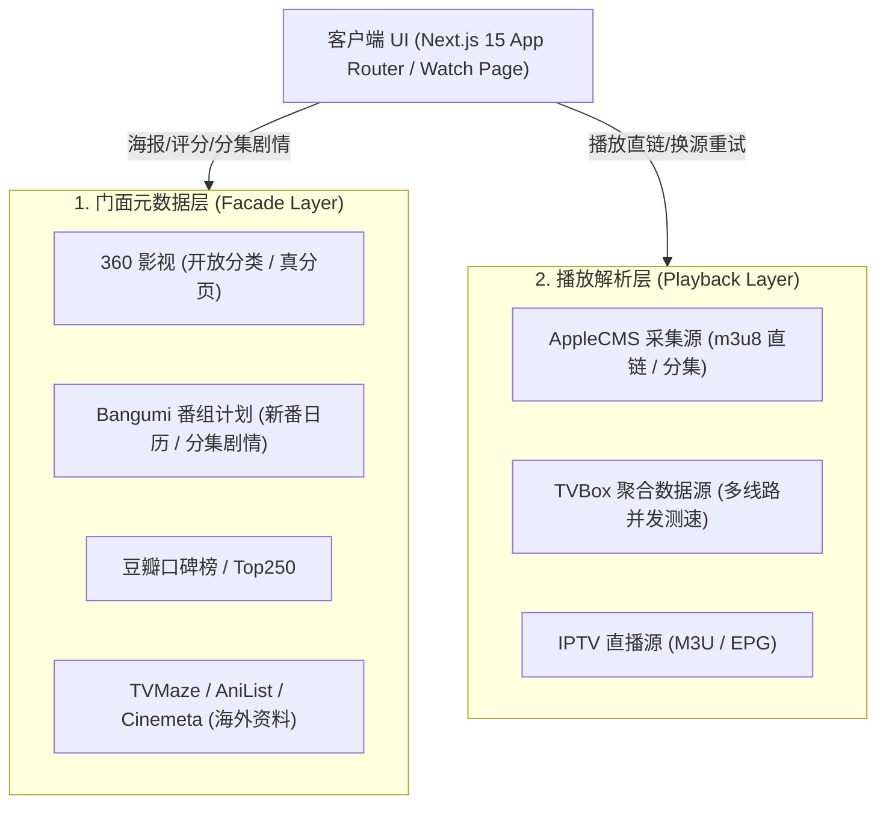

# LibreTV 工程开发与协作规范 (Development Specification)

> 本规范是 LibreTV 项目的核心工程准则，参与维护的开发者与智能体必须遵守。
> 规范的作用是把「踩过的坑」固化下来；如与实际冲突，以代码现状为准并同步修订本文。

---

## 目录
- [一、Git 工作流与 CI/CD 交付规范](#一git-工作流与-cicd-交付规范)
- [二、开发环境与统一检查](#二开发环境与统一检查)
- [三、系统架构与数据链路分层](#三系统架构与数据链路分层)
- [四、前端 UI/UX 视觉工程与设计系统规范](#四前端-uiux-视觉工程与设计系统规范)
- [五、性能优化与图片加载准则](#五性能优化与图片加载准则)
- [六、代码质量、测试与防御性工程纪律](#六代码质量测试与防御性工程纪律)

---

## 一、Git 工作流与 CI/CD 交付规范

### 1. 核心红线：严禁直接 Push 到 Master

`Master` 受 Render 持续部署监听，**任何推送到 `Master` 的行为都会直接触发生产部署**。
CI 对 Master 的运行属于「事后记录」——它跑在部署之后，绿灯拦不住这一次上线。
真正的门禁只对 **Pull Request 与功能分支**生效。

### 2. 标准分支开发流

```mermaid
gitGraph
   commit id: "Initial"
   branch feature/recommend-carousel
   checkout feature/recommend-carousel
   commit id: "feat: 横向滚动轨道"
   commit id: "test: 补充单测"
   checkout Master
   merge feature/recommend-carousel id: "PR #12 Merged"
```

1. 同步主干：`git checkout Master && git pull origin Master`
2. 切分支：`feature/功能描述`、`fix/缺陷描述`、`hotfix/故障描述`、`docs/说明`
   （CI 与自动合并只认这四类前缀）
3. 本地自验：`npm run check`（见第二节）
4. 推送：`git push origin feature/xxx`
5. 创建 Pull Request 到 `Master`

### 3. CI 门禁与自动合并

CI 在 `.github/workflows/ci.yml`，四个**并行 job**（必须拆成独立 job，不能写成单 job 连续 steps——
step 失败会跳过后续，掩盖其余门禁）：

| Job | 命令 |
|---|---|
| 类型检查 | `npm run typecheck` |
| 单元测试 | `npm test -- --pool=forks ...` |
| ESLint | `npm run lint` |
| 生产构建 | `npm run build` |

`.github/workflows/enable-auto-merge.yml` 会在 PR 打开时对同仓库的 `feature/**`、`fix/**`、
`hotfix/**`、`docs/**` 分支执行 `gh pr merge --auto --squash`（GitHub 原生自动合并）。

> ⚠️ 自动合并只在「必需检查全部满足」后才合并。若 `Master` 未配置
> `Require status checks to pass`，没有任何必需检查 → PR 一开就立刻合并，
> **CI 还没跑完代码就进了 Master，门禁形同虚设**。
> 需在 Settings → Branches → Master 勾上该项并选中上述四个检查名。

### 4. 提交信息规范 (Conventional Commits)

前缀采用标准语义动词，`feat:` / `fix:` / `refactor:` / `perf:` / `test:` / `style:` / `docs:`。
正文用中文或英文均可，重点是说清**为什么改**；涉及取舍时把被否决的方案一并记下。

---

## 二、开发环境与统一检查

- **Node 版本固定 22**：根目录 `.nvmrc` 与 `package.json` 的 `engines` 均已声明，
  与 Docker、CI 保持一致。建议 `nvm use` 读取 `.nvmrc`。
- **统一使用 `npm ci`**：不要用 `npm install` 更新锁文件；依赖变更须显式提交 `package-lock.json`。
- **提交前必跑统一检查**：

```bash
npm run check
```

它依次执行 `typecheck` → `lint` → `test` → `build`。
其中 `test` 带 `--pool=forks --poolOptions.forks.singleFork=true --poolOptions.forks.maxForks=1`：
vitest 默认多线程会显著拉高内存，在 CI 与本机都容易被 OOM Killer 杀掉（表现为无输出中断）。

---

## 三、系统架构与数据链路分层

LibreTV 采用 **元数据门面层 + 播放数据采集层** 解耦的双层流媒体架构：



### 1. 门面元数据层
负责片名、海报、评分、演职员表、单集剧情、更新状态。
严禁在服务端高频调用存在防盗链与 IP 阻断的接口（豆瓣 403/418），优先走开放、高可用的直连通道。

### 2. 播放解析层
负责采集站解析、TVBox 规则源、直播流提取。采用流式并发匹配先到先播，
播放页提供**最优线路测速建议**与**自动故障转移**。

### 3. 服务端安全防线 (SSRF Guard)
所有服务端外部请求（`fetchUpstream`）必须经过 `checkUpstreamAllowed` 校验，
严禁请求内网私有地址（`127.0.0.1`、`10.0.0.0/8`、`192.168.0.0/16`、`172.16.0.0/12`）。

> **新增任何对外请求的 API 路由，必须接入 SSRF 校验**——这是安全红线，不是可选项。

### 4. CMS 分类 ID 跨源不统一（重要）

采集站的分类 `type_id` 在各站之间**完全不同**，只能按分类名匹配，不能依赖固定 ID。
实测 `t=51` 分别是：红牛=AI漫剧、光速=擦边短剧、森林=女优系列、360=反转爽剧、
新浪=穿越年代、豪华=脑洞悬疑、ikun=NBA、暴风=电影解说。

因此 `resolveCmsTypeId` 在源站无对应分类时返回 `undefined`；
专属频道（`ai_comic` / `movie_commentary`）拿不到分类 ID 时必须直接返回空结果，
**绝不能省略 `t` 参数裸拉全站**（会得到全站混合内容，表现为「解说栏目里全是电影」）。

---

## 四、前端 UI/UX 视觉工程与设计系统规范

保持天涯影视 + 9zhoukj 影院级沉浸感暗黑风格。

### 1. 语义化设计 Token（业务 UI 优先）

页面优先使用 `tailwind.config.ts` 中的语义化 CSS 变量：

- 背景层级：`bg-page` → `bg-surface` → `bg-surface-raised` → `bg-chip`
- 文字层级：`text-content` → `text-muted` → `text-faint`
- 边框线色：`border-line`、`border-line/60`
- 品牌主色：`bg-accent`、`text-accent`、`border-accent`、`text-on-accent`

优先使用 Token 是为了主题一致与可维护性；在 Token 确实无法表达的场景
（如渐变、遮罩、第三方组件内联样式）允许具名颜色，但应集中、可查，不要散落各处。

### 2. 空间布局与信噪比（横向滚动优先）

- 首页纵向高度宝贵：推荐源统一采用**单行横向滚动轨道**，不堆叠折行大网格。
- 卡片尺寸参考 `w-[125px] sm:w-[145px] md:w-[160px] shrink-0`，轨道高度收敛在 ~210px。
- 骨架屏排版必须与真实卡片 1:1 几何对齐，杜绝加载抖动。

### 3. 新增频道必须四处同步（缺一即出现「加了但点不到」）

1. 桌面顶部导航 / 全频道抽屉
2. 移动端频道栏与侧栏
3. 路由高亮判定（`header.tsx` 中 `t` → 频道的映射）
4. 国际化文案（`src/lib/i18n.tsx`）

频道定义应保持**单一来源**，桌面、平板、移动侧栏从同一份数据生成，避免遗漏。

### 4. 响应式与可访问性基线

- 新功能至少覆盖 **桌面** 与 **375px 宽度移动端** 两种形态。
- 图标按钮必须有 `aria-label`；装饰性图片 `alt=""`，内容图片提供降级文案。
- 自动轮播在键盘聚焦、触摸操作与「减少动态效果」(`prefers-reduced-motion`) 下暂停，并提供暂停按钮。
- 抽屉、弹窗、播放器需通过键盘 Tab / Esc 回归。

---

## 五、性能优化与图片加载准则

### 1. 严禁无脑代理图片

历史事故：全量通过 `/api/proxy/[url]` 代理海报会导致所有图片请求挂起，
服务器带宽与连接池耗尽，拖垮搜索与播放接口。

`SmartImage` 策略：默认 `direct` 直连；仅遇明确防盗链（403/418）时降级。
优先使用无防盗链的开放 CDN（360kan `qhimg.com`、爱奇艺 `iqiyipic.com`、Bangumi `bgm.tv`、Cinemeta CDN）。

### 2. 接口缓存与客户端 Query 管理

- 服务端上游数据用 `getCache` / `setCache` 包裹，避免重复请求打爆上游。
- TanStack Query：静态元数据 / 排行榜 `staleTime: 30 * 60_000`；搜索结果避免过度缓存脏数据；
  分集剧情按集数唯一 key 缓存。

---

## 六、代码质量、测试与防御性工程纪律

### 1. 变量与作用域防呆（防 TDZ）

必须避免在变量声明之前于其他 Hook 或事件中引用它。书写顺序：

1. Router & Store 参数获取
2. 主查询 Hooks
3. 衍生变量计算
4. 次级联动 Hooks
5. 交互回调与生命周期 Effects
6. JSX 模板渲染

### 2. 测试基线

- **所有测试必须通过**，不允许存在失败或 `.skip` 用例。
- 新增核心逻辑（尤其 `src/lib/` 下的模块）必须补对应 `*.test.ts`。
- 不要为凑数量写无效断言；测试要能真正拦住回归。

```bash
npm test -- --pool=forks --poolOptions.forks.singleFork=true --poolOptions.forks.maxForks=1
```

### 3. 组件体积

单组件超过约 **500 行** 时应考虑拆分（筛选状态 / 数据查询 / 列表渲染 / 交互面板分离），
避免一个文件同时承担取数、状态机与模板三件事。

### 4. 新增环境变量必须三处同步

`.env.example`、`README.md` 环境变量表、`docker-compose.yml`。
不同步会导致他人部署时静默走到默认值，排查成本极高。

### 5. 文件安全红线（防物理硬删）

禁止在自动化脚本或调试中静默执行 `rm -rf` 等不可逆硬删；
清理文件必须使用回收站兜底工具，确保具备回滚通道。
