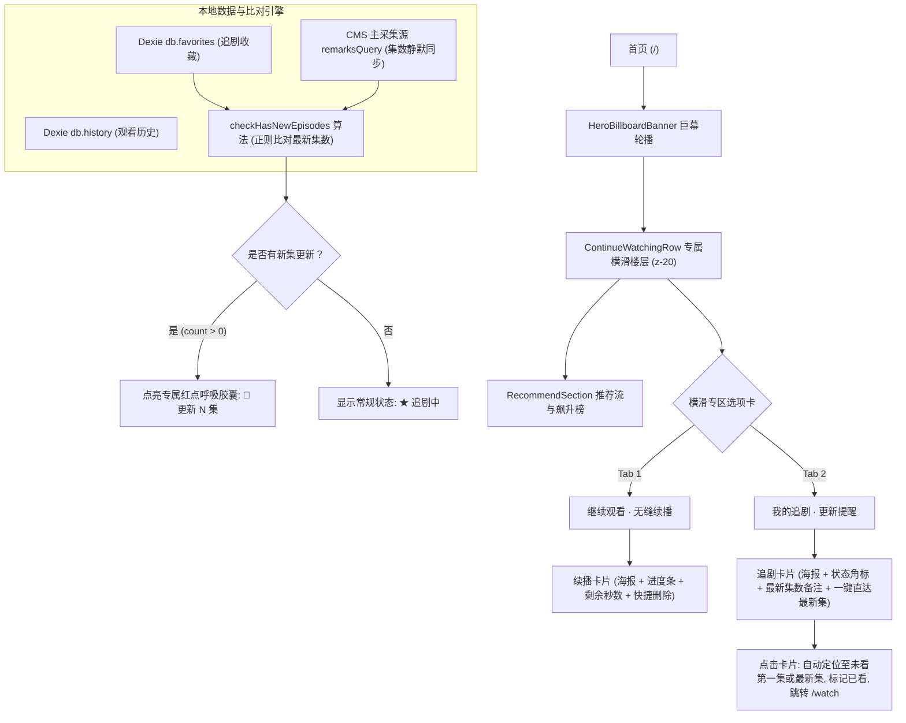
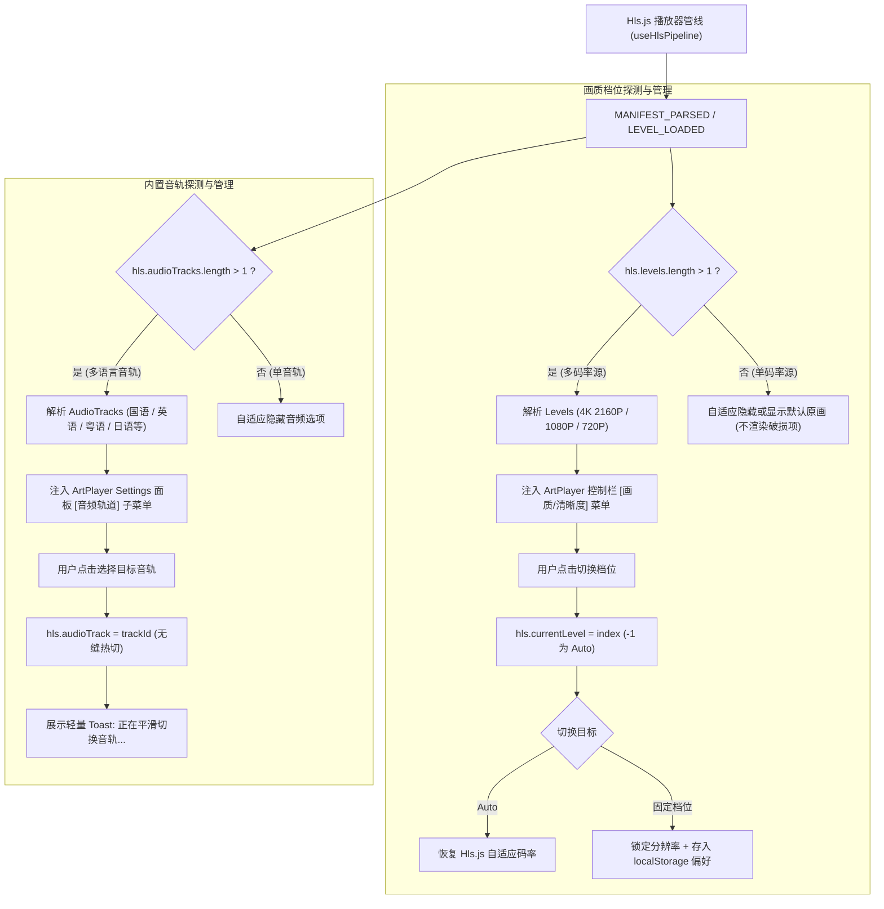
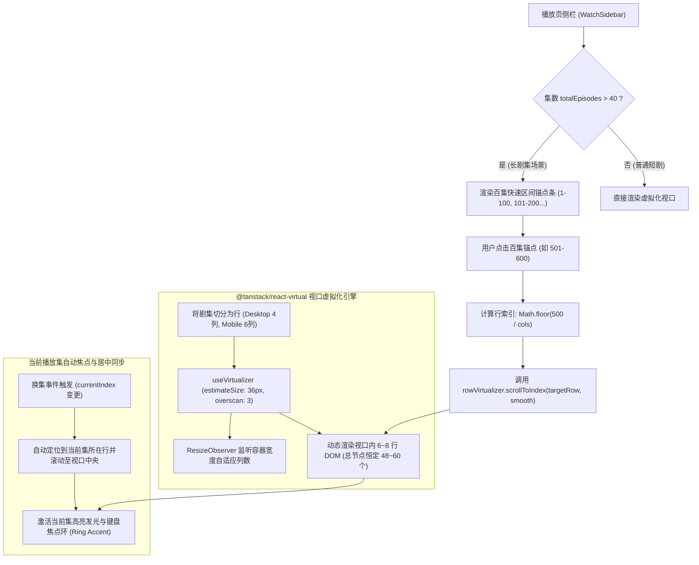
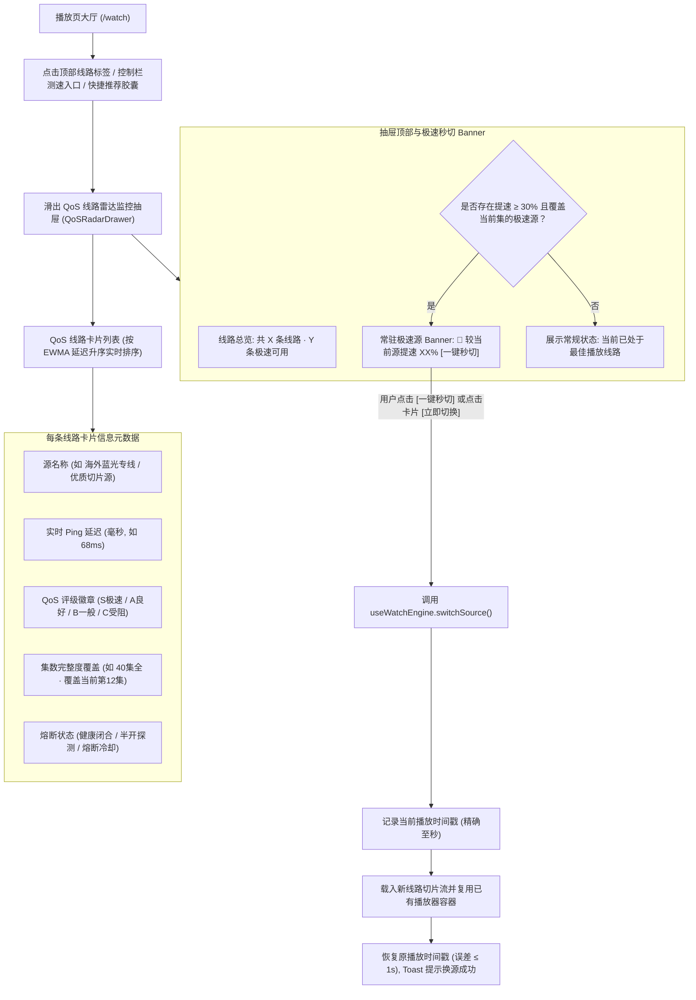
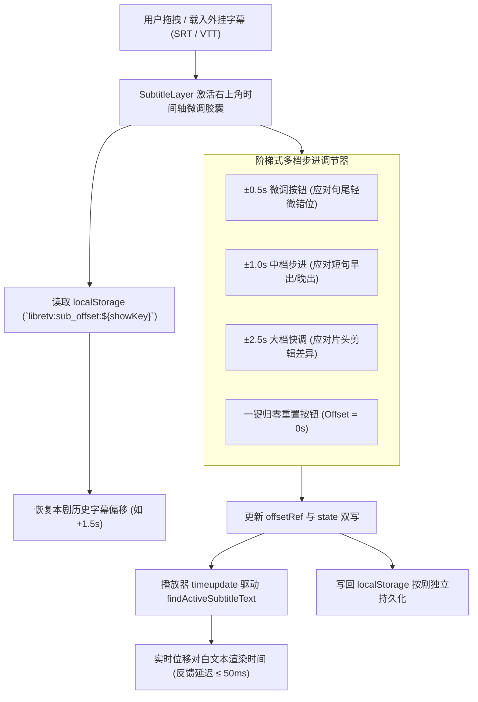
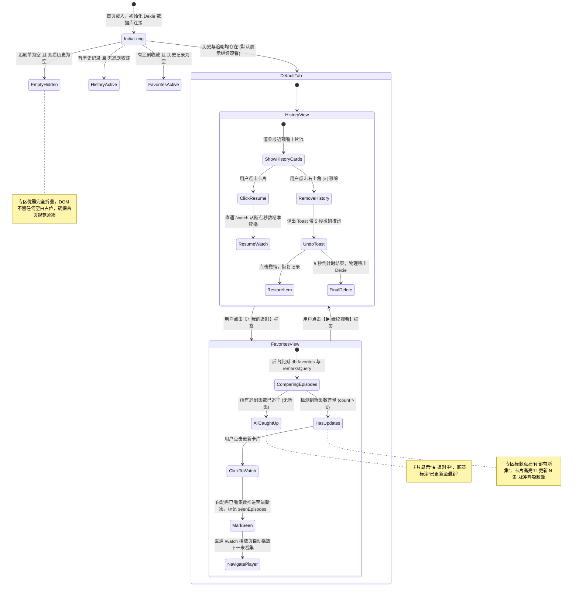
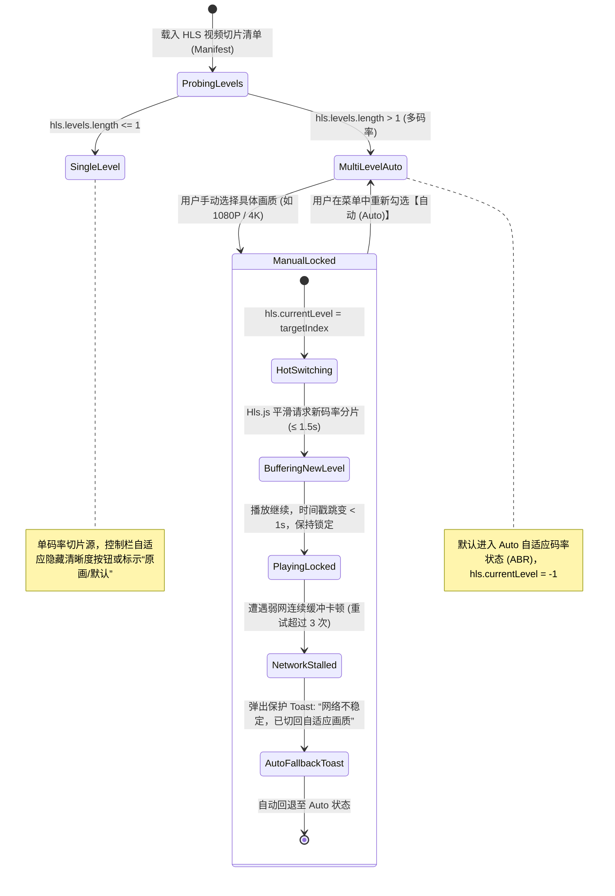
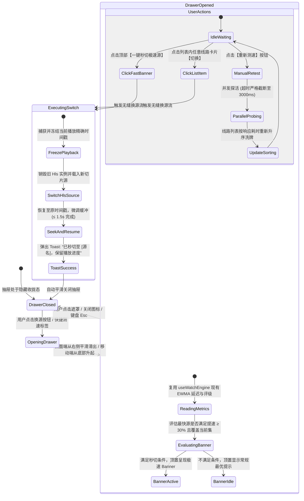

# information-architecture.md — LibreTV v1.2 信息架构与状态流转设计

**产品**：LibreTV (cl.tv) 流媒体与聚合视听平台  
**版本**：v1.2 (Gate 2 / R2 UI 设计交付)  
**设计角色**：UI/UX 设计师 (ui-ux-designer)  
**基准需求**：`team-deliverables/pm/iteration-plan.md` (Gate 1 用户裁决方案 B)  
**技术约束**：`team-deliverables/dev/tech-feasibility-assessment.md`  
**交付归属**：`team-deliverables/design/information-architecture.md`  
**生效日期**：2026-11-05  

---

## 0. 设计定位与升级背景

在 LibreTV v1.2 迭代中，根据系统主管与用户的正式裁决（方案 B：稳健收敛），针对 6 大核心体验断层实施全套 UI/UX 架构升级：
1. **REQ-P0-01**：HLS 视频多清晰度（画质档位）选择与锁定（Auto / 1080P / 720P / 4K）；
2. **REQ-P0-02**：内置多语言音频轨道无缝切换（国英双语 / 原声日语 / 粤语等）；
3. **REQ-P0-03**：1000 集长剧选集 `@tanstack/react-virtual` 虚拟化滚动重构；
4. **REQ-P0-04**：首页“我的追剧·最近更新”动态流专区与智能红点提示（Hero 巨幕下方、推荐流上方；追平或为空时自适应优雅折叠）；
5. **REQ-P0-05**：播放线路 QoS 综合监控雷达抽屉与“一键秒切极速源”；
6. **REQ-P1-01**：外挂字幕时间轴毫秒级阶梯步进微调与按剧持久化。

本文档详细定义页面层级拓扑、导航结构、数据实体关系及核心功能的状态转移图（State Machine Flow），为线框图原型（`wireframes.md`）、视觉规范（`ui-spec.md`）及后续研发与验收提供严密依据。

---

## 1. 系统全景地图与层级结构 (Sitemap & Page Hierarchy)

```
LibreTV (cl.tv)
├── / 首页 (HomePage)
│   ├── Header 顶部玻璃导航栏 (Logo / 全局搜索 / 频道切换 / 设置 / 登录状态)
│   ├── Hero 巨幕大轮播 (4K 趋势海报 / 快速起播 / 影视档案入口)
│   ├── 🌟 [v1.2 核心] 追剧动态与无缝续播横滑专区 (ContinueWatchingRow)
│   │   ├── 胶囊选项卡：【▶ 继续观看】 / 【⭐ 我的追剧 (🔴有新集更新)】
│   │   ├── 追剧动态卡片 (更新红点 / 最新集数差量 / 一键直达最新未看集)
│   │   └── 续播历史卡片 (精准进度百分比 / 秒数续播 / 单条删除及撤销)
│   ├── 左图右榜双栏楼层 (推荐影视流 MediaCard + 热门飙升榜)
│   ├── 底层采集源深度流式扫描视图 (可展开，流式并发探针)
│   └── SiteFooter 全局页脚
├── /watch 播放页 (WatchPage)
│   ├── 顶部自适应悬浮导航条 (返回 / 标题 / 当前源名与延迟徽章 / 测速换源抽屉触发器 / 跨屏接力 / 追剧开关)
│   ├── 左主视区：环境光影 + 播放器核心 (PlayerShell)
│   │   ├── ArtPlayer 播放内核 (Web/系统全屏 / 倍速 / 比例 / 截图)
│   │   ├── 🌟 [v1.2 核心] 控制栏清晰度切换菜单 (Auto / 1080P / 720P / 4K 档位热切与锁定)
│   │   ├── 🌟 [v1.2 核心] 设置面板音频轨道切换子项 (国语 / 英语 / 日语 / 粤语等内置音轨热切)
│   │   ├── 🌟 [v1.2 核心] 外挂字幕渲染与右上角阶梯微调胶囊 (±0.5s / ±1.0s / ±2.5s / 重置)
│   │   ├── 播放器内右侧悬浮感应贴边选集抽屉 (全屏模式选集)
│   │   └── 播放器底部主控与快捷线路栏 (含当前线路延迟与雷达抽屉快捷入口)
│   ├── 右侧栏 (WatchSidebar，桌面端常驻 / 移动端折叠)
│   │   ├── 🌟 [v1.2 核心] 1000 集长剧虚拟化滚动选集面板 (Virtual Episode Grid)
│   │   │   ├── 顶部排序与控制栏 (剧集总数 / 正序倒序切换)
│   │   │   ├── 百集快速区间锚点条 (1-100 / 101-200 / 201-300 / ...)
│   │   │   └── 虚拟化视口网格容器 (恒定 48~60 DOM 节点，当前集居中焦点高亮)
│   │   ├── 本集剧情看点 (动漫/剧集单集简介展开)
│   │   ├── 影视资料与海报墙 (年份 / 地区 / 分类 / 演职员纯文本 / 剧照)
│   │   └── 猜你喜欢相关推荐流
│   └── 🌟 [v1.2 核心] 全局右侧滑出 QoS 线路雷达监控抽屉 (QoSRadarDrawer)
│       ├── 抽屉顶部：线路全景统计 + 测速刷新按钮
│       ├── 顶置推荐：常驻极速源一键秒切 Banner (🚀 提速百分比 / 目标延迟 / 一键秒切)
│       ├── QoS 线路雷达列表 (EWMA 毫秒延迟 / S-A-B-C 评级徽章 / 集数覆盖度 / 熔断器状态)
│       └── 抽屉底部操作栏 (手动重新并发测速 / 线路筛选)
├── /catalog 片库大厅 (CatalogPage)
├── /history 观看历史页 (HistoryPage)
├── /settings 设置中心 (SettingsPage)
└── /login 登录与邀请注册 (LoginPage)
```

---

## 2. 6 大核心功能信息架构图

### 2.1 首页“我的追剧·最近更新”动态流架构 (REQ-P0-04)



### 2.2 播放器画质与多音轨二级控制流架构 (REQ-P0-01 & REQ-P0-02)



### 2.3 1000 集长剧选集虚拟化与快速锚点联动架构 (REQ-P0-03)



### 2.4 播放线路 QoS 综合监控雷达抽屉与秒切状态流架构 (REQ-P0-05)



### 2.5 外挂字幕时间轴阶梯微调与持久化架构 (REQ-P1-01)



---

## 3. 核心交互状态转移图 (State Transition Diagrams)

### 3.1 首页追剧专区状态转移机 (ContinueWatchingRow State Machine)



### 3.2 播放器画质档位热切与锁定状态转移机 (Video Quality State Machine)



### 3.3 QoS 综合监控雷达抽屉与秒切状态转移机 (QoS Radar Drawer State Machine)



---

## 4. 路由参数与跨页面持久化契约

### 4.1 URL 路由参数定义规范

| 路由 | 参数名 | 类型 | 说明 | 示例 |
|:---|:---|:---|:---|:---|
| `/watch` | `title` | string | 影视标准名称 (用于多源匹配) | `title=三体` |
| `/watch` | `year` | string | 上映年份 (用于辅助消歧) | `year=2023` |
| `/watch` | `index` | number | 当前播放集索引 (0-indexed) | `index=0` (第1集) |
| `/watch` | `sourceKey` | string | 选定点播源唯一标识 | `sourceKey=bfzym3u8` |
| `/watch` | `sourceUrl` | string | 点播源接口 URL (用于离线解析) | `sourceUrl=https%3A%2F%2F...` |
| `/watch` | `position` | number | 秒级续播断点时间戳 (可选) | `position=1420` (第23分40秒) |
| `/watch` | `quality` | string | 初始偏好画质锁 (可选) | `quality=1080p` |

### 4.2 本地存储 (LocalStorage & IndexedDB) 数据键契约

| 存储媒介 | Key 命名规则 | 数据结构 | 用途说明 |
|:---|:---|:---|:---|
| `Dexie db.favorites` | 表 `favorites` | `{ id, title, sourceKey, lastKnownEpisodes, seenEpisodes, remarks, timestamp }` | 首页追剧更新红点对比与集数追踪 |
| `Dexie db.history` | 表 `history` | `{ id, title, episodeIndex, playbackPosition, duration, timestamp }` | 首页继续观看断点续播 |
| `LocalStorage` | `libretv:sub_offset:${showKey}` | `number` (如 `1.5`, `-0.5`) | 外挂字幕时间轴微调按剧持久化 |
| `LocalStorage` | `libretv:preferred_quality` | `'auto' \| '4k' \| '1080p' \| '720p'` | 用户画质档位全局偏好记忆 |
| `LocalStorage` | `libretv:sidebar_reversed` | `boolean` | 长剧选集正序/倒序排列偏好 |